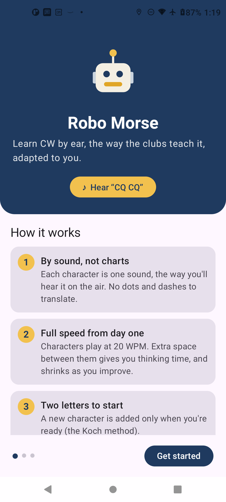
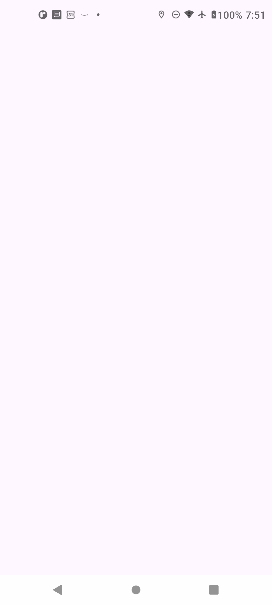
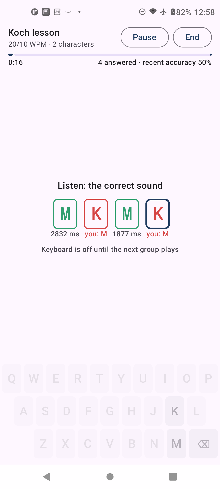
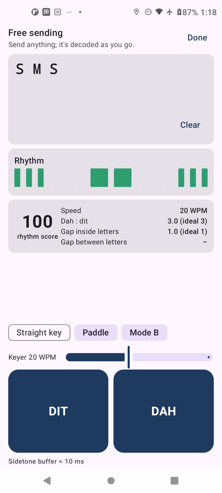

# Robo Morse

An Android app for learning Morse code (CW) by ear, built around the methods that
serious CW training groups use, with an adaptive engine that spends more time on
what you find hard and less on what you've mastered.

<p>
  
  
  
  
</p>

## Why another Morse app?

Most of what works in Morse training is well established. The clubs that turn out
competent operators (Long Island CW Club, CW Academy, LCWO and others) agree on the
basics, and learning research explains why they work. Robo Morse puts those basics
in one place and adds an engine that adapts to the learner.

| Principle | What the app does | Basis |
|---|---|---|
| Learn by sound | Receive training is sound only: no dot-dash charts or mnemonics | Koch (1936); club consensus |
| Fast characters from day one | Characters at 20 WPM; extra Farnsworth spacing between them, reduced as you improve | Avoids counting dits and the ~10 WPM plateau |
| Koch method | Start with two characters; add one only after sustained accuracy of 90% or more | Koch; LCWO; LICW |
| Instant recognition | Response time counts toward mastery, not just accuracy | CW Academy; Morse Code Ninja |
| Retrieval practice | Every drill is a recall test with immediate feedback | Roediger & Karpicke (2006) |
| Spaced, short sessions | Daily goals, a "done for today" point, spaced review of each character | Cepeda et al. (2006) |
| Desirable difficulty | Selection keeps accuracy near 85% | Wilson et al. (2019) |

The motivation features (character map, goals, forgiving streaks, breathers) reward
real skill rather than time spent, and the app tells you when to stop.

See [PLAN.md](PLAN.md) for the full design, including the evidence behind each choice.

## Features

**Receiving**
- **Koch lessons:** groups of 3–5 characters, weighted toward weak characters and pairs
  you confuse. Includes the next-character unlock, introductions of new characters, and
  between-session speed adjustment.
- **ICR sprint:** one character at a time, timed from the moment its sound ends.
- **Word & callsign copy:** hear a whole word, ham abbreviation or callsign and type it.
  Levels run Short words → Words → Callsigns → Mixed and follow how you're doing; misses
  are replayed and come back a few items later, and shorthand like QTH or 73 is explained.
- **Refresher:** for coming back after a break. Characters return two at a time in Koch
  order, each reintroduced with its sound and pattern, in short, slightly slower groups.
  Missed characters are always replayed. Suggested on the home screen after 5 days
  away, and offered mid-lesson if accuracy drops near guessing.
- **Head copy:** a word or phrase plays with nothing to type, then you pick it from four
  look-alike choices (for example HAS, HAD, HIS, WAS). Levels run from short words to
  contact phrases.
- **Say it:** hear a character, group or word and say it out loud, as a phonetic word
  ("Kilo") or letter name, using Android's speech recognizer. Untimed; the answer is shown
  with each character's phonetic word and pattern. Needs microphone permission; on Android
  12+ recognition runs on the phone where supported, otherwise through the system speech
  service.

**On the air**
- **Callsign ladder:** a run of 25 callsigns at full speed. Each one copied makes the
  next 2 WPM faster, each miss slower; points are length × speed, and your best run is kept.
- **On-air practice:** a simulated contact, one over at a time: CQ, then report, name and
  location, then power, antenna and weather. Copy what goes in the log, check it, and see
  the whole over with its shorthand explained. Set your own callsign in Settings.
- **Accurate timing:** tones are synthesized with click-free edges, and character end
  times come from the audio clock (`AudioTimestamp`), so output latency doesn't distort
  response times.
- **Fixed-layout answer keyboard:** large keys that never move, with unlearned keys
  dimmed and timing taken from touch-down. Bluetooth keyboards work too.
- **Pacing:** adjustable gap between groups, periodic breathers, pause and automatic
  pause when interrupted, and optional replay of missed characters.

**Sending**
- On-screen **straight key** or **iambic paddle** (Mode A/B, with dit/dah memory).
- Low-latency sidetone (about 10 ms buffer on a mid-range phone).
- **Free sending** with a live decoder that adapts to your speed.
- **Echo:** hear a character or group, then send it back.
- **Rhythm feedback:** a timeline of your marks, the dah:dit ratio and gaps compared
  with ideal timing, and a 0–100 rhythm score.

**Progress**
- A character map coloured by mastery tier (New → Learning → Solid → Instant).
- A daily goal ring, forgiving streaks (two freezes a month) and a weekly goal.
- Stats: an overview, session history chart, per-character accuracy and response time
  history, and a confusion heatmap.
- An optional daily reminder, skipped if you've already practiced.

Everything runs offline, with no account. Data stays on the device.

## Building

Requirements: JDK 17 and the Android SDK (platform 35). Android Studio provides both.

```sh
./gradlew :morse-core:test        # core logic unit tests
./gradlew :app:assembleDebug      # build the APK
./gradlew :app:installDebug       # install on a connected device
```

Minimum Android version: 8.0 (API 26).

## Project layout

```
morse-core/   Pure Kotlin, no Android: Morse table, PARIS/Farnsworth timing, Koch
              curriculum, learner model and adaptive engine, streaks, send decoder,
              fist analysis, iambic keyer. Unit-tested.
app/          Android app (Kotlin, Jetpack Compose, Room, DataStore)
  audio/      Tone synthesis and playback, low-latency sidetone
  data/       Database, settings, repository
  ui/         Screens: onboarding, home, practice, summary, stats, settings, send
PLAN.md       Design document and roadmap
```

## Roadmap

- Common words, Q-codes and prosigns; callsign copy; head-copy self-grading
- Games: Callsign Chase, Word Sprint, Pileup
- Saving sending results to stats; badges and personal bests
- Contest/POTA exchanges and a simulated QSO
- Band conditions (noise, fading); USB key/paddle support

## Credits and references

Method and order of characters follow the Koch method as used by
[LCWO](https://lcwo.net), with ideas from the
[Long Island CW Club](https://longislandcwclub.org) and
[CW Academy](https://cwops.org/cw-academy/). Research references are listed in
[PLAN.md](PLAN.md#15-references). This project is not affiliated with any of them.

## Use of AI

This project was built with heavy AI assistance, and it's fair to say so up front.

- **Who did what:** the design, research summary and nearly all of the code were
  written by Anthropic's Claude (via Claude Code), working from the project owner's
  goals and feedback. The owner decided what to build, tested each version on real
  phones, and asked for the changes (pacing, pause, replay behaviour and so on).
- **How it was checked:** the core logic (timing, adaptive engine, decoder, keyer,
  streaks) has unit tests, and every feature was run on an Android device before
  being committed. That doesn't make it bug-free; issues are welcome.
- **What still needs a human check:** the research claims in [PLAN.md](PLAN.md) and
  the in-app "Did you know?" facts were written from the AI's knowledge plus limited
  web searches. They haven't all been checked against primary sources yet (this is
  tracked in the code). Treat them as a starting point, not citations.
- **Commits:** commits that include AI-written code carry a `Co-Authored-By: Claude`
  trailer.

## License

[MIT](LICENSE)
